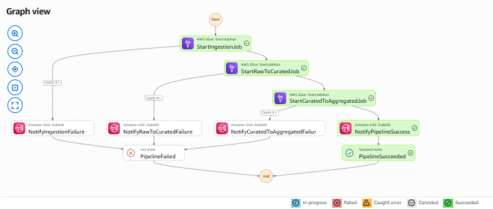
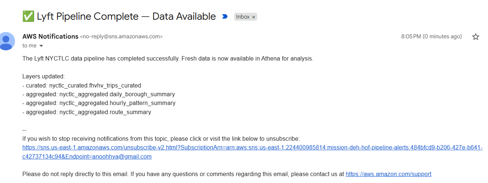

# NYC TLC — Lyft (HVFHV) Data Engineering Pipeline

## Overview

This project implements an end-to-end **batch + event-driven data pipeline** that
ingests NYC Taxi & Limousine Commission (TLC) **High Volume For-Hire Vehicle
(HVFHV)** trip data — filtered to **Lyft** records (`hvfhs_license_num = HV0005`)
— from the public NYC TLC CloudFront distribution into AWS, transforms it through
a **medallion architecture** (raw → curated → aggregated), and exposes it for
analyst self-service via Athena.

The pipeline is orchestrated by **AWS Step Functions**, triggered on a monthly
cron schedule by **EventBridge Scheduler**, with **SNS** success/failure
alerts and **DynamoDB** job-audit tracking on every run.

---

## Architecture


**SNS** notifications fire on every pipeline success and on any step failure.
**S3 Lifecycle rules** transition data across storage tiers for cost
optimization across all three medallion layers.

---

## AWS Services Used

| Service | Role in this Pipeline |
|---|---|
| **AWS Glue (Python Shell)** | Ingestion job — downloads HVFHV Parquet + zone lookup from CloudFront and uploads to the S3 **raw** layer |
| **AWS Glue (Spark ETL)** | Transformation jobs — raw→curated enrichment/cleansing and curated→aggregated rollups |
| **Amazon S3** | Medallion data lake: `raw → curated → aggregated` layers |
| **Glue Crawlers + Data Catalog** | Automatically infer schemas and register tables so analysts can query without manual DDL |
| **Amazon Athena** | Analyst self-service — serverless SQL over the Data Catalog tables |
| **AWS Step Functions** | Orchestrates the 3 Glue jobs sequentially with catch-based error routing |
| **Amazon SNS** | Publishes pipeline success + per-step failure alerts (`mission-deh-hof-pipeline-alerts`) |
| **EventBridge Scheduler** | Cron-based monthly trigger that starts the Step Functions execution |
| **AWS Lambda** | S3 event-driven trigger for real-time processing on new object arrival |
| **Amazon DynamoDB** | Job audit tracking (`mission-deh-hof-job-audit`) + pipeline metadata registry |
| **S3 Lifecycle rules** | Cost optimization — tiered storage transitions across medallion layers |
| **Data quality reporting** | Rejected records tracked with reasons (filter violations, unrealistic speeds/durations) |

---

## Project Structure

```
NYC-TLC/
├── nyctlc-ingestion.py                  # Glue Python Shell — ingest HVFHV + zone lookup → raw
├── raw-to-curated.py                     # Glue ETL (Spark) — cleanse, enrich, join → curated
├── curated-to-aggregated.py             # Glue ETL (Spark) — roll up curated → 3 aggregated tables
├── mission-deh-hof-pipeline-state-machine.json   # Step Functions ASL definition
└── README.md                            # This file
```

---

## Data Source

- **Provider**: NYC Taxi & Limousine Commission (TLC)
- **Dataset**: High Volume For-Hire Vehicle (HVFHV) Trip Records — Lyft only (`HV0005`)
- **Format**: Parquet (trip data), CSV (taxi zone lookup)
- **Source URL patterns**:
  ```
  https://d37ci6vzurychx.cloudfront.net/trip-data/fhvhv_tripdata_{year}-{month:02d}.parquet
  https://d37ci6vzurychx.cloudfront.net/misc/taxi+_zone_lookup.csv
  ```
  Hosted on a public AWS CloudFront distribution managed by NYC TLC. No
  authentication is required. The ingestion job auto-detects the latest 6
  available months (NYC TLC data lags ~2 months behind real time).

---

## S3 Data Lake (Medallion Architecture)

Bucket: `mission-deh-hof-nyctlc-<ACCOUNT_ID>` (auto-detected from caller identity)

```
s3://mission-deh-hof-nyctlc-<ACCOUNT_ID>/
├── raw/
│   ├── nyctlc/fhvhv_tripdata/          # Raw HVFHV Parquet (last 6 months)
│   └── nyctlc/taxi_zone_lookup/         # Raw zone lookup CSV
├── curated/
│   └── nyctlc/fhvhv_trips_curated/      # Cleansed, enriched, zone-joined (partitioned by pickup_date)
└── aggregated/
    ├── nyctlc/daily_borough_summary/   # Daily metrics per borough
    ├── nyctlc/hourly_pattern_summary/  # Hour/weekend/borough patterns
    └── nyctlc/route_summary/           # Pickup→dropoff zone route metrics
```

**S3 Lifecycle rules** transition older objects across storage tiers
(Standard → Infrequent Access → Glacier) to optimize cost across all three
layers.

---

## Pipeline Stages

### Stage 1 — Ingestion (`nyctlc-ingestion.py`) — Glue Python Shell

1. Auto-detects the latest 6 available HVFHV months from CloudFront (HTTP HEAD checks)
2. Streams each Parquet file to S3 raw via **multipart upload** (10 MB chunks)
3. Downloads the taxi zone lookup CSV to the raw layer
4. Writes a job-audit record to DynamoDB (`mission-deh-hof-job-audit`)

| Glue Job Name | `mission-deh-hof-nyctlc-ingestion` |
|---|---|

### Stage 2 — Raw → Curated (`raw-to-curated.py`) — Glue ETL (Spark)

1. Reads raw HVFHV Parquet and **filters to Lyft only** (`hvfhs_license_num = HV0005`)
2. **Data quality filters**:
   - `trip_miles` between 0 and 200
   - `base_passenger_fare` between 0 and 500
   - `trip_time` between 0 and 14,400 seconds (4 h)
   - `pickup_datetime` not null and `dropoff_datetime > pickup_datetime`
   - `PULocationID` / `DOLocationID` not null
3. **Derived columns**: `trip_duration_minutes`, `pickup_date`, `pickup_hour`,
   `pickup_day_of_week`, `is_weekend`, `speed_mph`, `is_shared_ride`,
   `wait_time_minutes`
4. **Secondary filters**: speed ≤ 80 mph, trip duration 1–240 minutes
5. **Joins** with zone lookup for pickup & dropoff borough/zone/service_zone
6. Writes to curated layer **partitioned by `pickup_date`**
7. **Rejected records tracked** with counts and reasons → DynamoDB audit

| Glue Job Name | `mission-deh-hof-raw-to-curated-etl` |
|---|---|

### Stage 3 — Curated → Aggregated (`curated-to-aggregated.py`) — Glue ETL (Spark)

Produces 3 aggregate tables:

| # | Table | Grain | Key metrics |
|---|---|---|---|
| 1 | `daily_borough_summary` | pickup_date × pickup_borough | total_trips, total_revenue, avg_fare, avg_tip, avg_trip_miles, avg_trip_duration, avg_speed |
| 2 | `hourly_pattern_summary` | pickup_hour × is_weekend × pickup_borough | total_trips, avg_fare, avg_tip_percentage, avg_speed, avg_wait_time |
| 3 | `route_summary` | pickup_zone → dropoff_zone | total_trips (≥ 10), avg_fare, avg_trip_miles, avg_trip_duration |

| Glue Job Name | `mission-deh-hof-curated-to-aggregated-etl` |
|---|---|

---

## Orchestration — Step Functions (`mission-deh-hof-pipeline-state-machine.json`)

The ASL state machine runs the three Glue jobs **synchronously** in sequence
using the `arn:aws:states:::glue:startJobRun.sync` resource pattern, which
blocks until each Glue job run completes before advancing to the next step.

### Execution Flow



### State Definitions

| State | Type | Resource | Purpose |
|---|---|---|---|
| `StartIngestionJob` | Task | `glue:startJobRun.sync` | Runs `mission-deh-hof-nyctlc-ingestion`; on success → `StartRawToCuratedJob` |
| `StartRawToCuratedJob` | Task | `glue:startJobRun.sync` | Runs `mission-deh-hof-raw-to-curated-etl`; on success → `StartCuratedToAggregatedJob` |
| `StartCuratedToAggregatedJob` | Task | `glue:startJobRun.sync` | Runs `mission-deh-hof-curated-to-aggregated-etl`; on success → `NotifyPipelineSuccess` |
| `NotifyIngestionFailure` | Task | `sns:publish` | Publishes step-1 failure details (job name + error + cause) → `PipelineFailed` |
| `NotifyRawToCuratedFailure` | Task | `sns:publish` | Publishes step-2 failure details → `PipelineFailed` |
| `NotifyCuratedToAggregatedFailure` | Task | `sns:publish` | Publishes step-3 failure details → `PipelineFailed` |
| `NotifyPipelineSuccess` | Task | `sns:publish` | Publishes success summary (all 3 jobs) → `PipelineSucceeded` |
| `PipelineFailed` | Fail | — | Terminal failure; error `PipelineExecutionFailed` |
| `PipelineSucceeded` | Succeed | — | Terminal success |

### Error Handling (Catch blocks)

Each Glue Task state includes a `Catch` that captures `States.ALL` errors,
stashes the error into `$.error` (`ResultPath: "$.error"`), and routes to the
matching SNS notification task. The SNS message is built with
`States.Format(...)` so the published alert includes:

- The failing **step name** (e.g. `StartIngestionJob`)
- The **Glue job name** (e.g. `mission-deh-hof-nyctlc-ingestion`)
- The **error** and **cause** from the failed run

All three failure paths converge on the `PipelineFailed` terminal state.

### SNS Topic

| SNS Topic | `mission-deh-hof-pipeline-alerts` |
|---|---|

The success notification confirms all 3 Glue jobs completed; failure
notifications identify exactly which step and job failed along with the
error details.

**Sample success notification received via email:**



### Triggers

- **EventBridge Scheduler** — cron-based monthly trigger that starts the state machine execution on a schedule.
- **Lambda** — S3 event-driven trigger for real-time processing when new objects land in the raw layer.

---

## Job Audit & Metadata (DynamoDB)

| Table | `mission-deh-hof-job-audit` |
|---|---|

Every Glue job writes an audit record on both success and failure:

| Attribute | Description |
|---|---|
| `job_name` | Glue job name |
| `run_timestamp` | ISO timestamp of the run |
| `layer` | `raw` / `curated` / `aggregated` |
| `records_read` | Records read from source |
| `records_written` | Records written to target |
| `records_rejected` | Records dropped by data quality rules |
| `duration_seconds` | Job runtime |
| `status` | `SUCCESS` / `FAILED` |
| `error_message` | Error details on failure |

This same table acts as the **pipeline metadata registry**, giving visibility
into run history, rejection volumes, and failures across all layers.

---

## Data Quality Reporting

Rejected records are quantified at each transformation stage:

- **Raw → Curated**: records failing range/null/temporal filters or the
  speed (≤ 80 mph) and duration (1–240 min) thresholds are dropped, and the
  rejection count + percentage is logged.
- Every rejection count flows into the DynamoDB audit record
  (`records_rejected`), so analysts can monitor data-quality drift over time.

---

## Analyst Self-Service (Glue Crawlers + Data Catalog + Athena)

- **Glue Crawlers** periodically scan the `curated/` and `aggregated/` S3
  prefixes, inferring schemas and registering/updating tables in the
  **AWS Glue Data Catalog**.
- **Amazon Athena** runs serverless SQL directly against those catalog tables,
  so analysts can query curated and aggregated data without provisioning
  infrastructure.

---

## AWS Account Details

| Field | Value |
|---|---|
| Account ID | `<AWS_ACCOUNT_ID>` |
| Region | `us-east-1` |
| S3 Bucket | `mission-deh-hof-nyctlc-<AWS_ACCOUNT_ID>` |
| SNS Topic | `mission-deh-hof-pipeline-alerts` |
| DynamoDB Table | `mission-deh-hof-job-audit` |
| Step Functions | `mission-deh-hof-pipeline` (state machine) |

---

## Deployment Summary

| Step | Status |
|---|---|
| S3 bucket created (medallion layers) | ✅ Done |
| Ingestion Glue Python Shell job | ✅ Done |
| Raw → Curated Glue ETL (Spark) job | ✅ Done |
| Curated → Aggregated Glue ETL (Spark) job | ✅ Done |
| Step Functions state machine (with SNS alerts) | ✅ Done |
| DynamoDB job-audit table | ✅ Done |
| Glue Crawlers + Data Catalog + Athena | ✅ Done |
| EventBridge Scheduler (monthly cron) | ✅ Done |
| Lambda (S3 event-driven trigger) | ✅ Done |
| S3 Lifecycle rules (cost optimization) | ✅ Done |
| Data quality reporting (rejected records) | ✅ Done |
